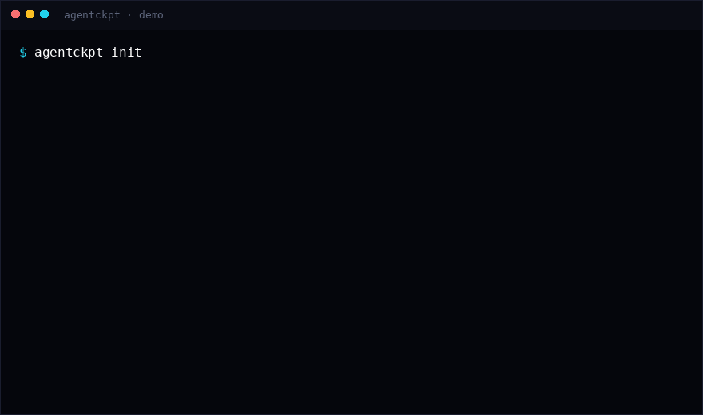

<p align="center"></p>

# agentckpt

**Checkpoint a working tree while coding agents run, and restore any snapshot without touching your git branches or index.**

<p align="center"></p>

## FAQ

**How big does the store get in long sessions?** Measured on a psf/requests clone, with one small edit per snap: ~4.2 MB after the first snapshot, ~9.4 MB after 200 (~27 KB each), because storage is content-addressed and unchanged files are deduplicated. Files over 10 MiB are skipped (`--max-bytes`), and `agentckpt prune --keep N` (default 50) trims old snapshots.

**What about `.gitignore` and big build dirs?** `.gitignore` is respected, so `build/`, `node_modules/`, `.venv/` and similar are never stored. To capture a specific ignored path, list it in `include_ignored`.

**Ignored `.env` or generated config?** Contents are not stored by default. Each snap records metadata only (path, size, mtime, hash), and `restore` warns if these files changed or went missing. Opt in with `include_ignored`; secret-looking files also need `allow_secrets = true` and are stored unencrypted. *This is on `main` and ships in the next release, not in v0.2.0* ([#4](https://github.com/Blackman99/agentckpt/issues/4)). Details: [configuration](docs/configuration.md).

Coding agents (Codex, Claude Code, Gemini CLI, OpenCode, Cursor agents, …) edit and delete files. Built-in `/undo` is often missing or unreliable — see [openai/codex#9203](https://github.com/openai/codex/issues/9203) (522👍, still open) and [V2EX](https://www.v2ex.com/t/1218209). agentckpt keeps a private shadow store under `.agentckpt/` so you can snap (including untracked files) and restore freely. It never runs `git add` / `git commit` or moves branches in your real `.git`.

## Install

```bash
uvx --from git+https://github.com/Blackman99/agentckpt agentckpt demo     # run without installing
pipx install git+https://github.com/Blackman99/agentckpt                  # or install the command
```

Zero Python dependencies, Python 3.9+, requires `git` on `PATH`. Wheels are on the [releases page](https://github.com/Blackman99/agentckpt/releases).

## Usage

```bash
agentckpt init
agentckpt snap -m "before agent"
# … agent rewrites the tree …
agentckpt ls
agentckpt restore <id> --force    # overwrite divergent files; omit --force to skip conflicts
```

Auto-snap while an agent works: `agentckpt watch`. Housekeeping: `agentckpt prune --keep 50`, `agentckpt doctor`.

## Agent hooks

Let the agent checkpoint before each prompt, before each edit or shell command, and after each turn. Every config calls `agentckpt hook`, which reads the hook JSON (last argument or stdin), finds the project from its `cwd`, and snaps with a message like `claude: before Edit src/app.py`. It always exits 0 and prints nothing on stdout, so it never blocks a prompt or denies a tool call.

```toml
# ~/.codex/config.toml — after every Codex turn
notify = ["agentckpt", "hook", "--source", "codex"]
```

```jsonc
// .claude/settings.json — before every prompt and every edit / shell command
{ "hooks": {
  "UserPromptSubmit": [{ "hooks": [{ "type": "command", "command": "agentckpt hook --source claude" }] }],
  "PreToolUse": [{ "matcher": "Edit|Write|MultiEdit|NotebookEdit|Bash",
                   "hooks": [{ "type": "command", "command": "agentckpt hook --source claude" }] }] } }
```

Drop-in configs for Codex (`notify` + `hooks.json`), Claude Code, Gemini CLI and an OpenCode plugin are in [`examples/`](examples/). Anything else: `agentckpt run -- aider`. Projects without `agentckpt init` are skipped. See the [hooks guide](https://blackman99.github.io/agentckpt/docs/hooks/).

**Docs:** [blackman99.github.io/agentckpt/docs](https://blackman99.github.io/agentckpt/docs/) · **Blog:** [English](https://blackman99.github.io/agentckpt/docs/blog/agent-undo-without-touching-git/) · [中文](https://blackman99.github.io/agentckpt/docs/blog/agent-undo-without-touching-git-zh/) · MIT
